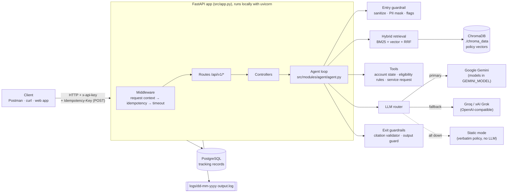
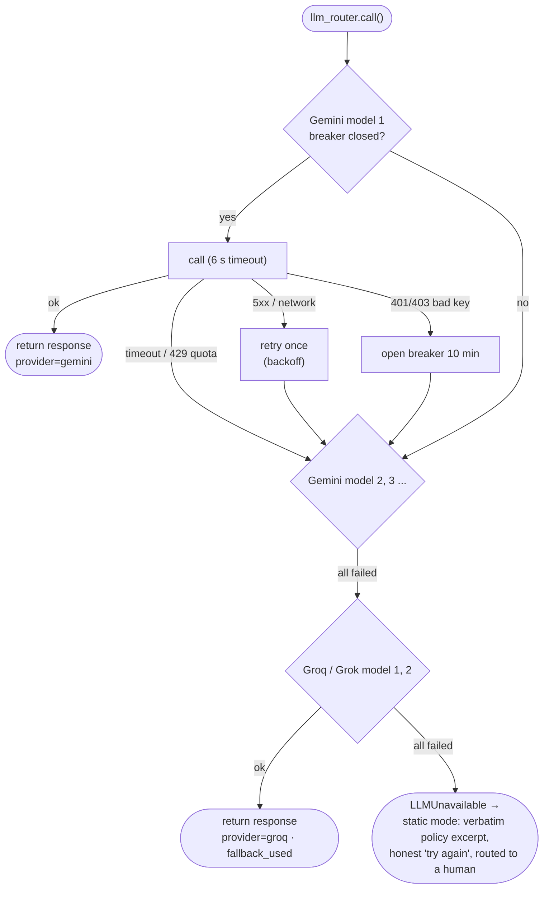
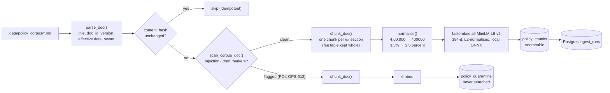
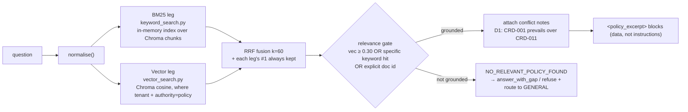

# Architecture and flow

The diagrams are Mermaid. They render on GitHub, and in VS Code with the *Markdown Preview Mermaid Support* extension (`Ctrl+Shift+V`).
Every box names the file that implements it.

## 1. The big picture



| Store | What lives there | Why there |
|---|---|---|
| **ChromaDB** (`./chroma_data`, embedded, no server) | policy chunks + their 384-d embeddings + metadata; quarantined docs in a separate collection | vector similarity search (HNSW, cosine) |
| **PostgreSQL** (local install) | `request_logs`, `idempotency_keys`, `traces`, `spans`, `conversations`, `messages`, `service_requests`, `prompt_versions`, `eval_runs`, `eval_results`, `ingest_runs` | relational, queryable audit trail: who called, from where, which model answered, what it cost |
| **Log file** (`logs/14-11-2026output.log`) | every event, one JSON line, with file / function / requestId | grep-able debugging when something goes wrong |

## 2. One `/chat` request, end to end

```mermaid
sequenceDiagram
    autonumber
    participant C as Client
    participant M as Middleware
    participant A as Agent (agent.py)
    participant G as Entry guard
    participant R as Retriever
    participant L as LLM router
    participant T as Tools
    participant V as Exit guards
    participant P as Postgres

    C->>M: POST /api/v1/chat {customer_id, message}<br/>x-api-key, Idempotency-Key
    M->>M: requestId = Idempotency-Key → log context
    M->>P: claim idempotency key (replay if already completed)
    M->>A: auth ✓ rate limit ✓ schema ✓ → run_agent()
    A->>G: sanitize + mask PII + flag injection / score / cross-customer
    A->>R: search_policy(question) — before the first model call
    R-->>A: policy excerpts (or NO_RELEVANT_POLICY_FOUND)
    loop max 6 iterations, 25 s budget
        A->>L: system prompt + tools + messages
        L-->>A: tool calls (Gemini; Groq/Grok if Gemini fails)
        A->>T: get_account_state / check_limit_increase_eligibility / raise_service_request / search_policy
        T-->>A: results (customer_id bound server-side, internal score redacted)
    end
    A->>V: respond(payload) → citation validator → output guard
    alt invalid
        V-->>A: errors → ONE repair turn → still invalid → safe response
    end
    A->>P: trace + spans, conversation messages
    A-->>M: structured answer
    M->>P: store response for the key + request_logs row
    M-->>C: 200 {status, customer_message, claims[citations], decision, routing, meta{provider, model}}
```

## 3. The LLM fallback chain



`LLM_FORCE_PRIMARY_FAIL=1` simulates a Google outage (to demo the fallback). `LLM_DISABLED=1` goes straight to static mode.

## 4. How policy text becomes vectors in ChromaDB (ingest)



Each Chroma record:

| field | example |
|---|---|
| `id` | `default:POL-FEE-007:Table` (tenant:doc:section; re-ingest replaces in place) |
| `document` | `POL-FEE-007 Fees and Charges Schedule §Table: \| Charge \| Amount \| ...` (shown, quoted, cited) |
| `embedding` | 384 floats |
| `metadata` | `doc_id, tenant_id, section, title, version, owner, effective_date, authority (policy/non_policy), quarantined, quarantine_reason, content_hash, text_norm, token_count` |

**How to see it:** `streamlit run tools/chroma_peek/app.py` (table, embedding map, live similarity query),
`GET /api/v1/admin/vector-store`, or `python -m scripts.ingest` output. Details are in the README section *See the embedded data*.

## 5. Hybrid retrieval



## 6. Guardrails: entry and exit

### Entry (before anything reaches the model)

| # | Guardrail | Where | What it stops |
|---|---|---|---|
| 1 | API key (constant-time compare), admin-only routes | `middleware/auth_middleware.py` | anonymous use, users calling admin endpoints |
| 2 | Idempotency-Key required on POST, replay / 409 / 422 | `middleware/idempotency_middleware.py` | duplicate side effects (double service requests) on client retries |
| 3 | Rate limit, 60/min per key | `middleware/rate_limit_middleware.py` | abuse, runaway cost |
| 4 | Schema validation (`extra=forbid`, `CUST-dddd`, 1–1000 chars) | `middleware/validate_middleware.py` | malformed / oversized input |
| 5 | Request timeout 30 s (agent budget 25 s) | `middleware/timeout_middleware.py` | hung requests |
| 6 | Sanitize: strip control, zero-width and bidi characters | `guardrails/input_guard.py` | hidden-text injection, log forging |
| 7 | PII masking: card, Aadhaar, PAN, e-mail, phone, OTP/CVV/PIN | `guardrails/pii.py` | PII reaching the LLM provider, Postgres or logs |
| 8 | Flags: injection, internal-score request, cross-customer id | `guardrails/input_guard.py` | (flags are *enforced* later by the validator) |
| 9 | customer_id bound server-side; no tool takes a customer id; no "approve" tool exists | `agent/tools_schema.py`, `tools/tool_runner.py` | reading another customer's data, approving anything |
| 10 | Internal score + name redacted before the model sees the account | `guardrails/redact.py` | score leakage at the source |
| 11 | Corpus quarantine at ingest (separate collection) | `scripts/ingest.py`, `db/chroma.py` | indirect prompt injection from documents (POL-OPS-012) |
| 12 | Retrieved text wrapped as `<policy_excerpt>` data | `retrieval/retriever.py` + prompt | instructions hidden inside documents |

### Exit (before anything reaches the customer)

| # | Guardrail | Where | What it stops |
|---|---|---|---|
| 1 | Schema check of the `respond` payload | `guardrails/citation_validator.py` | unstructured / malformed answers |
| 2 | Every claim cited; cited doc+section must have been retrieved **this turn** | same | invented sources, citing the quarantined doc |
| 3 | Quotes must be verbatim (else dropped, never shown) | same | fake quotations |
| 4 | Every number in a claim must appear in a cited source or computed fact | same | invented fees, rates, dates, multipliers |
| 5 | Reason codes only AA01–AA06 and only those the rules engine returned | same | invented / misapplied decline reasons |
| 6 | Status consistency; injection / cross-customer ⇒ `refused`; a decline cites its rule doc; a raised request cites POL-SVC-006 | same | policy behaviour left to the model's discretion |
| 7 | Conflicts: never rely on the losing doc alone (D1/D5) | same | superseded policy |
| 8 | Output guard: internal score, approval language, sales to vulnerable customers, flag disclosure, prompt leak, OPS-012, other customers' ids, **PII** | `guardrails/output_guard.py` | leaks and forbidden content |
| 9 | One repair turn, then a safe response (never a guess) | `agent/agent.py`, `agent/safe_responses.py` | shipping an unverified answer |
| 10 | Request bookkeeping from the real tool result (request id, queue, SLA) | `agent/agent.py::_complete_routing` | invented reference numbers |
| 11 | Error envelope without stack traces | `middleware/error_middleware.py` | internal detail leaking in errors |

## 7. Logging and tracking

* **File log**: `logs/<dd-mm-yyyy>output.log`, one JSON object per line:
  ```json
  {"date": "2026-11-14 23:01:26.182", "type": "error",
   "message": "Grounded-Card-RAG | src/controller | chat_controller.py | worker | requestId: e2e-stream-0001 | message: chat_stream_failed",
   "stack": "Traceback (most recent call last): ..."}
  ```
  `requestId` = the request's Idempotency-Key (or `x-request-id`, or a generated uuid). It also appears on `traces.request_id`, `request_logs.request_id` and the `x-request-id` response header, so one id ties all four together.
* **Postgres `request_logs`**: one row per request: `source` (postman / curl / browser / `x-client-source`), `client_ip`, `user_agent`, `provider`, `model_used`, `fallback_used`, `agent_status`, `status_code`, `latency_ms`, `error_code`, `trace_id`.
* **Postgres `traces` + `spans`**: the inside of one agent turn (every LLM call with tokens and cost, every tool attempt, retrieval scores, validation errors).
