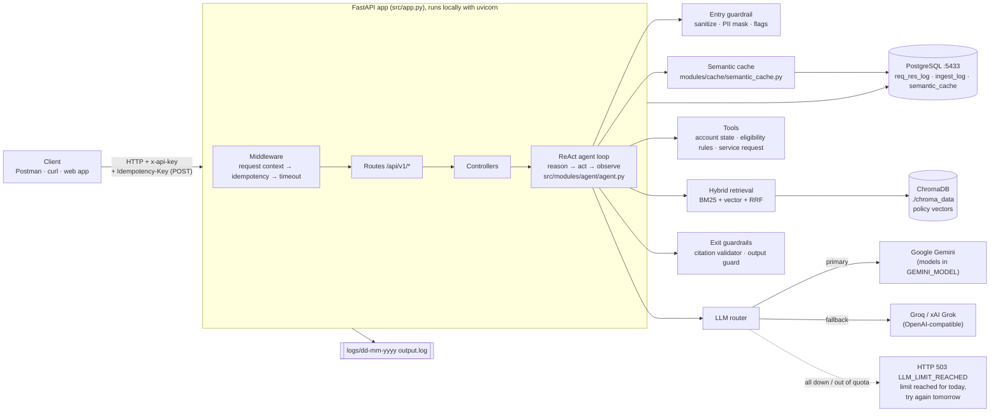
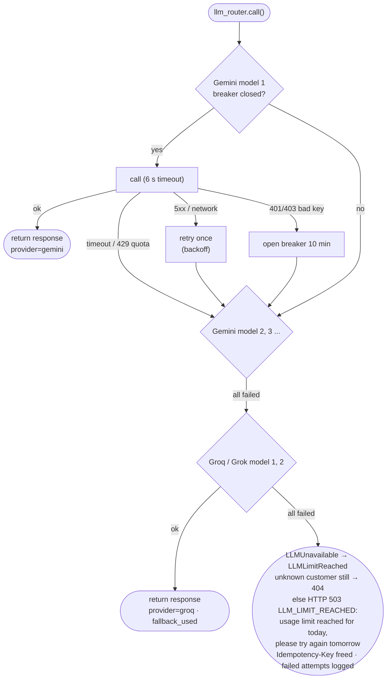
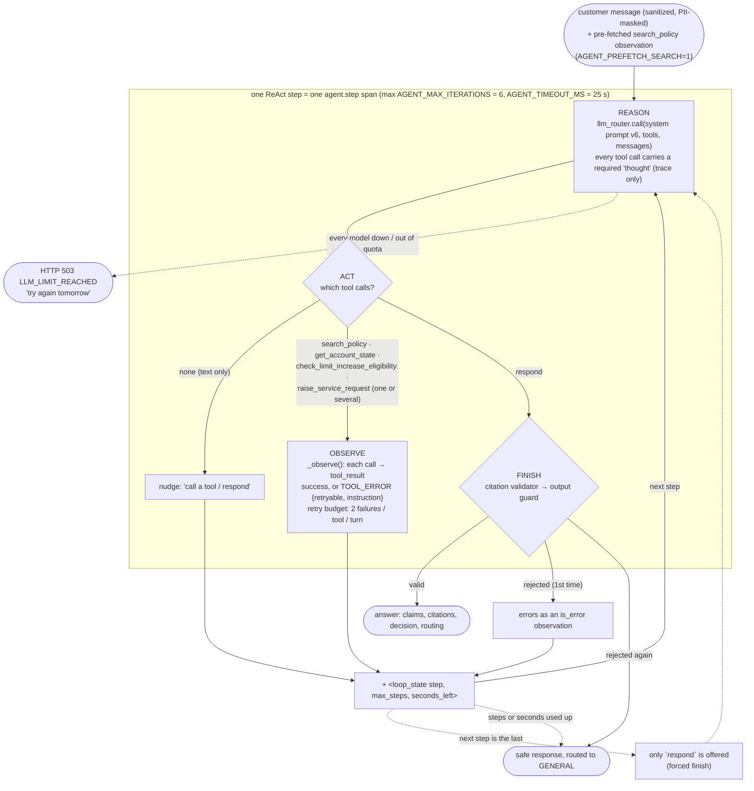
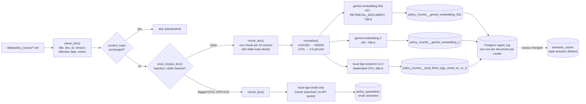
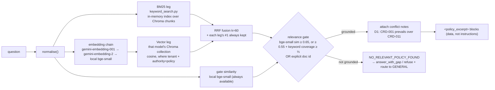
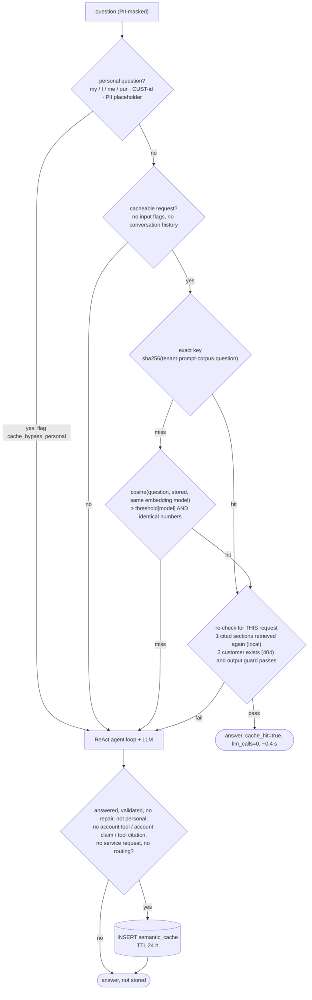
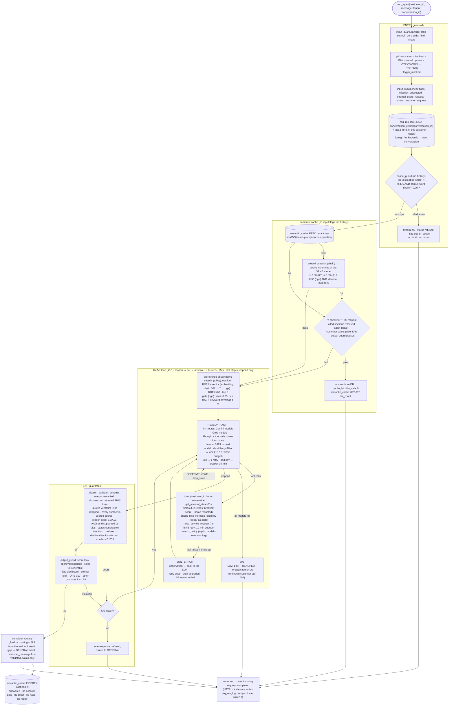
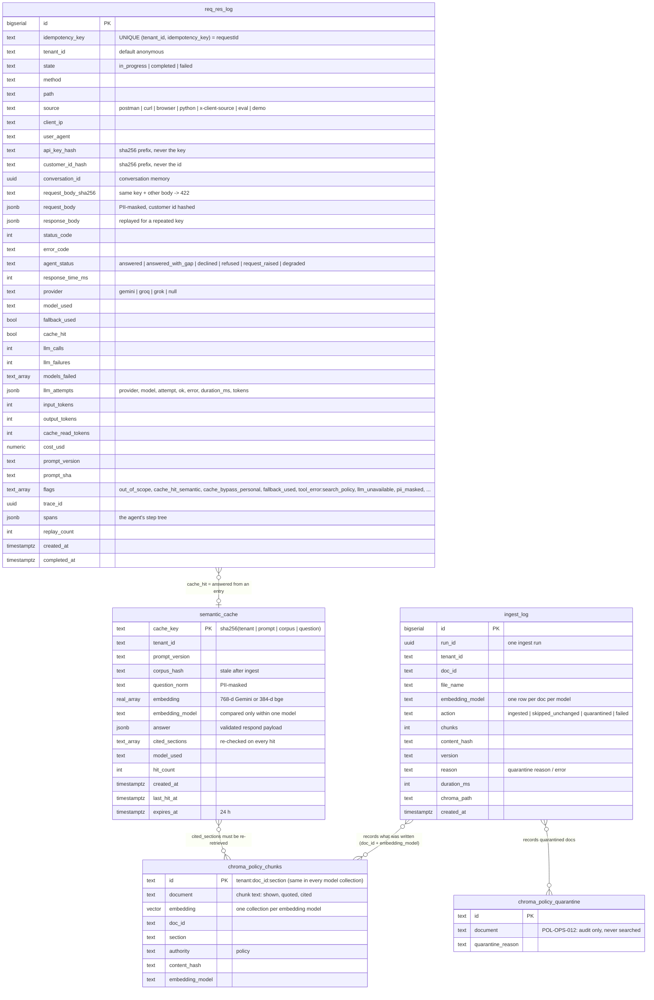

# Architecture and flow

The diagrams are Mermaid. They render on GitHub, and in VS Code with the *Markdown Preview Mermaid Support* extension (`Ctrl+Shift+V`).
Every box names the file that implements it.

## 1. The big picture



| Store | What lives there | Why there |
|---|---|---|
| **ChromaDB** (`./chroma_data`, embedded, no server) | policy chunks + metadata, **one collection per embedding model** (Gemini 001 768-d, Gemini 2 768-d, local bge-small 384-d); quarantined docs in a separate collection | vector similarity search (HNSW, cosine) |
| **PostgreSQL** (local install, port 5433) | exactly **3 tables**: `req_res_log`, `ingest_log`, `semantic_cache` (§7) | relational, queryable: who called, from where, which model answered, what it cost; ingest audit; reusable answers |
| **Files** | prompts (`prompts/system.vN.md`), eval reports (`eval/results/run-*.json/.md`) | versioned / diffable artefacts, not records you query |
| **Log file** (`logs/14-11-2026output.log`) | every event, one JSON line, with file / function / requestId | grep-able debugging when something goes wrong |

## 2. One `/chat` request, end to end

```mermaid
sequenceDiagram
    autonumber
    participant C as Client
    participant M as Middleware
    participant A as Agent (agent.py)
    participant G as Entry guard
    participant R as Retriever
    participant L as LLM router
    participant T as Tools
    participant V as Exit guards
    participant P as Postgres

    C->>M: POST /api/v1/chat {customer_id, message}<br/>x-api-key, Idempotency-Key
    M->>M: requestId = Idempotency-Key → log context
    M->>P: claim req_res_log row for the Idempotency-Key (replay if already completed)
    M->>A: auth ✓ rate limit ✓ schema ✓ → run_agent()
    A->>G: sanitize + mask PII + flag injection / score / cross-customer
    A->>P: semantic_cache lookup (exact key, then cosine ≥ threshold[embedding model] + same numbers)
    alt cache hit, re-checked for this request
        A-->>M: cached answer (no LLM): citations re-retrieved, output guard for this customer
    end
    A->>R: search_policy(question) — pre-fetched observation before step 1 (AGENT_PREFETCH_SEARCH=1)
    R-->>A: policy excerpts (or NO_RELEVANT_POLICY_FOUND, or TOOL_ERROR)
    loop ReAct: max 6 steps, 25 s budget (one agent.step span each)
        A->>L: REASON: system prompt v6 + tools + messages (+ loop_state)
        L-->>A: "Thought: …" + ACT: tool call(s) (Gemini; Groq if Gemini fails)
        A->>T: get_account_state / check_limit_increase_eligibility / raise_service_request / search_policy
        T-->>A: OBSERVE: results or TOOL_ERROR (customer_id bound server-side, score redacted)
        Note over A,L: last step: only `respond` offered (forced finish)
    end
    A->>V: FINISH: respond(payload) → citation validator → output guard
    alt invalid
        V-->>A: errors = next observation → ONE repair step → still invalid → safe response
    end
    Note over A,L: every model down / out of quota → HTTP 503 LLM_LIMIT_REACHED
    A->>P: store answer in semantic_cache (only if account-independent and clean)
    A-->>M: structured answer + trace (LLM attempts, tokens, spans)
    M->>P: complete the req_res_log row: response, response time, model, tokens, cost, failures
    M-->>C: 200 {status, customer_message, claims[citations], decision, routing, meta{provider, model}}
```

## 3. The LLM fallback chain



`LLM_FORCE_PRIMARY_FAIL=1` simulates a Google outage (to demo the fallback). `LLM_DISABLED=1` goes straight to the 503.

**No model, no answer.** There is no static or mock answer.
- **When every model in the chain fails** (daily free-tier quota used up, an outage, or `LLM_DISABLED=1`): the API returns **HTTP 503** `{"error": {"code": "LLM_LIMIT_REACHED", "message": "We've reached our usage limit for today. Please try again tomorrow."}}`, or an SSE `error` event with the same code.
- **The Idempotency-Key:** a 503 marks the request row `failed`, which frees the key so the same request can be retried later.
- **What is still recorded:** the `req_res_log` row keeps every failed model attempt (`llm_attempts`, `models_failed`).
- **What still works without a model:** an unknown customer is still a 404. Semantic-cache hits and off-domain replies need no model, so they keep working.
- **Code:** `agent.py::_no_model_available` → `LLMLimitReached` → `chat_controller` → `AppError("LLM_LIMIT_REACHED")`.

### 3.1 The ReAct agent loop

The agent is a **ReAct loop** (Reason → Act → Observe, repeated until it finishes). It is written out step by step in `agent/agent.py::_loop`, and the model uses its provider's native tool calling.



**What each part is, in code:**

| ReAct part | What happens | Code |
|---|---|---|
| **Reason** | The model reads the conversation so far (question, observations, `<loop_state>`) and picks the next action(s). **Every tool, including `respond`, has a required `thought` argument**: one sentence on what it still needs and why this call gets it. Code strips it before the tool runs or the answer is validated, and records it in the trace. It is **never** shown to the customer. *Why an argument, not "write Thought:" text:* measured live, Gemini flash-lite (a model with built-in thinking) ignored a text instruction, but it always fills a required argument. | `tools_schema.THOUGHT`, `_args`, `_thought` |
| **Act** | One or more tool calls in the same step. Independent lookups run together, e.g. account and policy at once. `respond` is the **finish** action. | `_observe`, `_run_tool` |
| **Observe** | Every result goes back as a `tool_result`, including failures (`TOOL_ERROR`, `ACCOUNT_STATE_UNAVAILABLE`, `NO_RELEVANT_POLICY_FOUND`, `InvalidCategory`) and a rejected answer (the validator's error list). | `_observe`, `_tool_error_observation` |
| **Loop state** | `<loop_state step="2" max_steps="6" seconds_left="17"/>` is appended to every observation, so the agent can plan when to stop. Before the last step it is told: *only `respond` is available next*. | `_loop_state` |
| **Finish** | `respond` → citation validator → output guard. Accepted → answer. Rejected once → the errors are the next observation (repair). Rejected twice → safe response. | `_finish` |
| **Forced finish** | On the last step the model is offered **only** the `respond` tool, so it must answer with what it can cite instead of running out of steps. | `FINISH_ONLY` |
| **Budget** | At most 6 steps and 25 s. The LLM router never waits past the deadline. Running out → safe response. | `_loop`, `config.agent_*` |
| **Memory** | *Working memory:* the `messages` list (every thought, action and observation of this turn) plus `TurnContext` (what was retrieved, the account state, requests raised), which the validator checks against. *Conversation memory:* the last 2 turns from `req_res_log`. | `TurnContext`, `_conversation` |
| **Trace** | One `agent.step` span per step, with `step`, `thought`, `actions`, `observations` (tool, ok) and `outcome` (`observed` · `no_action` · `finished` · `rejected_repair` · `rejected_again`). These are stored in `req_res_log.spans` and printed by `scripts/demo.py`. | `Trace.span` |

**Where it is deliberately *not* pure ReAct:**
- **Pre-fetched search.** Before step 1, code runs `search_policy` on the raw question and hands the agent the result as an observation (`<initial_policy_search>`). This saves one model round-trip; sequential calls blew the 25 s budget in the eval. The agent still decides whether to search again in its own words. Set `AGENT_PREFETCH_SEARCH=0` for pure ReAct, where the agent chooses every action.
- **Deterministic guards around the loop.** The entry guards, scope check and semantic cache run *before* the loop. The validator and output guard judge the *finish* action. Request bookkeeping (request id, queue, SLA) is filled in from the real tool result, not from the model's text. The model decides *what to do*; code decides *whether the answer is allowed out*.

**Real traces** (recorded 2026-11-20 on gemini-3.1-flash-lite, prompt v6):
```
"I want my credit limit increased to 3 lakh."  (CUST-2003, open dispute)          -> declined, 2 LLM calls
  step 1/6 outcome=observed actions=['get_account_state', 'check_limit_increase_eligibility']   (parallel)
     thought: [get_account_state] I need the account state to check eligibility for a limit increase.
              [check_limit_increase_eligibility] I need to run the eligibility check for the requested limit increase.
  step 2/6 outcome=finished actions=['respond']
     thought: [respond] I have determined the request must be declined due to an open dispute, which is a mandatory
              decline reason, and I have addressed the missing data gap.

"What is the foreign currency markup?"  (CUST-2007)                                -> answered, 1 LLM call
  step 1/6 outcome=finished actions=['respond']
     thought: [respond] The foreign currency markup is clearly stated in the fee schedule.
```
The second question finishes in one step because the pre-fetched search observation already holds the fee table. `python -m scripts.demo` prints the same steps as `ReAct step n/6` with timings.

### 3.2 When a tool, retrieval or the database fails

A **failure is an observation too**. It never crashes the turn. Failure handling has two layers:

| Layer | Who decides | What it does | Where |
|---|---|---|---|
| **Code-owned retries** | code | Retries *transient* errors before the model sees anything: timeouts, backoff + jitter, circuit breakers, the embedding-model chain | `tools/tool_runner.py`, `retrieval/embedder.py`, `llm/llm_router.py`, `helper/async_utils.py` |
| **Model-owned recovery** | the LLM | Receives a structured `TOOL_ERROR` observation and chooses the next action: retry once, reword the search, or answer honestly with what it already has (`status: degraded`) | `agent/agent.py::_observe`, `_record_tool_error`, `_tool_error_observation` |

**Retry budget.** Each tool may fail **twice per turn**:
- **First failure:** `retryable: true`. The model may call the tool once more.
- **Second failure:** `retryable: false`. Any further call is **not executed**; it gets a `RetryBudgetExhausted` observation.

`raise_service_request` is never retryable, because a failed call may already have created the request. This bounds the cost and latency of a dead dependency. The 25 s agent budget and the 6-iteration cap still apply on top.

The observation the model receives:
```json
{"error": "TOOL_ERROR", "tool": "search_policy", "error_type": "TimeoutExceeded", "retryable": true,
 "instruction": "search_policy failed. You may call it once more (search_policy: you may reword the query). If it fails again, do not guess what it would have returned."}
```

**Every failure, and what happens:**

| Failure | Code layer | What the model observes | What the customer gets |
|---|---|---|---|
| Gemini embedding API down / out of quota | Next model in the chain (Gemini 2, then local bge-small); breaker per model | Nothing (transparent). Flag `embedding_fallback:<model>` | Normal answer |
| Every embedding model down | BM25 only; the gate needs keyword coverage ≥ 0.5 | Normal search results | Normal answer, or an honest gap |
| **Chroma / vector store error, or retrieval > 10 s** (`RETRIEVAL_TIMEOUT_MS`) | `with_timeout` around `retriever.search` | `TOOL_ERROR` (retryable once). Flag `tool_error:search_policy` | Retry works → normal answer; otherwise `degraded`, or the safe response routed to GENERAL |
| Up-front search (before the 1st LLM call) fails | Counted as the 1st failure | `<initial_policy_search status="failed">` | The model searches itself (1 retry left) |
| `get_account_state` timeout (1 in 12 by design) | 2 s timeout, 2 retries with backoff, breaker | `ACCOUNT_STATE_UNAVAILABLE` (do not guess) | `degraded`: "couldn't retrieve your account details just now" |
| Account / eligibility tool raises anything else | none | `TOOL_ERROR` (retryable once); `account_unavailable` blocks every account claim | Retry works → normal answer; otherwise `degraded` |
| `raise_service_request` timeout | **No retry** (may already exist); 10-minute dedupe | `REQUEST_STATUS_UNKNOWN` | "I couldn't confirm your request was submitted" |
| `raise_service_request` raises anything else | No retry | `TOOL_ERROR`, `retryable: false`; a repeat call is not executed | Same as above |
| Invalid queue category | none | `InvalidCategory` + the allowed list; a second mistake → GENERAL | Request raised in a valid queue |
| Unknown customer | `CustomerNotFound` propagates (not recoverable) | none | HTTP 404 |
| **Every LLM down / out of quota** | Router chain exhausted | none (no model left to observe) | **HTTP 503 `LLM_LIMIT_REACHED`**: "try again tomorrow" (§3) |
| Answer fails validation / output guard | none | Error list as an `is_error` tool result: **1 repair** | Safe response, routed to GENERAL |
| 25 s budget or 6 ReAct steps used up | Loop stops (the last step already offered only `respond`) | none | Safe response |
| **Postgres down** | Idempotency check fails open (no replay protection); conversation memory empty; semantic cache skipped; `req_res_log` write failure is logged | none | The answer is still served. **Known gap:** each DB step waits for the connection timeout, so a dead DB can push a request past 30 s → 504. Fix: a circuit breaker on Postgres (README §7) |

Every failure shows up in `meta.flags` and `req_res_log.flags` (`tool_error:*`, `tool_timeout`, `embedding_fallback:*`, `llm_unavailable` …). Failed or degraded turns are never written to the semantic cache.

## 4. How policy text becomes vectors in ChromaDB (ingest)



Each Chroma record:

| field | example |
|---|---|
| `id` | `default:POL-FEE-007:Table` (tenant:doc:section; re-ingest replaces in place) |
| `document` | `POL-FEE-007 Fees and Charges Schedule §Table: \| Charge \| Amount \| ...` (shown, quoted, cited) |
| `embedding` | 768 floats (Gemini) or 384 (bge-small), unit length |
| `metadata` | `doc_id, tenant_id, section, title, version, owner, effective_date, authority (policy/non_policy), quarantined, quarantine_reason, content_hash, text_norm, token_count, embedding_model` |

**How to see it:** `streamlit run tools/chroma_peek/app.py` (table, embedding map, live similarity query),
`GET /api/v1/admin/vector-store`, or `python -m scripts.ingest` output. Details are in the README section *See the embedded data*.

## 5. Hybrid retrieval



### Embeddings: which model does what (measured on this corpus)

| Measured | gemini-embedding-001 | gemini-embedding-2 | local bge-small-en-v1.5 |
|---|---|---|---|
| Right policy in top 5, hybrid (39 questions incl. paraphrases) | **34** | **34** | not re-measured (MiniLM: 29) |
| Right policy ranked #1, vector | **32** | 28 | not re-measured (MiniLM: 23) |
| Paraphrase ↔ "different detail" similarity (cache) | **0.89–0.92 ↔ 0.81** | 0.90–0.94 ↔ 0.86 | 0.86–0.94 ↔ 0.85 |
| Gate: uncovered questions grounded (of 11) | 4 (0 covered refused) | 9 (0 covered refused) | **2** (2/26 raw covered refused, both grounded after the agent's reformulation; 0.65/0.55) |

So each job uses the model that is best at it:
- **Ranking + semantic cache:** the chain gemini-embedding-001 → gemini-embedding-2 → local bge-small. The first model that answers is used, and that model's own collection.
- **"Is this covered at all?":** the relevance gate always uses local bge-small (it replaced all-MiniLM-L6-v2 on 2026-11-15). It runs in milliseconds, can't run out of quota, and its thresholds were measured on 53 probes; like Gemini it compresses scores (unrelated questions 0.45–0.65), so its margin is thin.
- **When things fail:**
  - Gemini quota or credit exhausted: next Gemini model, then local bge-small. Each has its own quota and collection, and the trace flag shows `embedding_fallback:<model>`.
  - Everything down: BM25 only (keyword coverage ≥ 0.5) and exact-key cache hits; flag `embedding_unavailable`.
- **Keyword half of the gate:** the share of the question's own specific terms (≥ 3 letters, not generic) found in the top BM25 hit. The old "any term matches" rule grounded 6 of 11 uncovered questions; the token "s" from "what's" matched.

## 6. Guardrails: entry and exit

### Entry (before anything reaches the model)

| # | Guardrail | Where | What it stops |
|---|---|---|---|
| 1 | API key (constant-time compare), admin-only routes | `middleware/auth_middleware.py` | anonymous use, users calling admin endpoints |
| 2 | Idempotency-Key required on POST, replay / 409 / 422 | `middleware/idempotency_middleware.py` | duplicate side effects (double service requests) on client retries |
| 3 | Rate limit, 60/min per key | `middleware/rate_limit_middleware.py` | abuse, runaway cost |
| 4 | Schema validation (`extra=forbid`, `CUST-dddd`, 1–1000 chars) | `middleware/validate_middleware.py` | malformed / oversized input |
| 5 | Request timeout 30 s (agent budget 25 s) | `middleware/timeout_middleware.py` | hung requests |
| 6 | Sanitize: strip control, zero-width and bidi characters | `guardrails/input_guard.py` | hidden-text injection, log forging |
| 7 | PII masking: card, Aadhaar, PAN, e-mail, phone, OTP/CVV/PIN | `guardrails/pii.py` | PII reaching the LLM provider, Postgres or logs |
| 8 | Flags: injection, internal-score request, cross-customer id | `guardrails/input_guard.py` | (flags are *enforced* later by the validator) |
| 8b | **Scope check, two tiers, from the corpus only**: off-domain iff the mean similarity of the 3 nearest policy chunks (local bge-small) < 0.475 **and** < 25% of the question's words occur in the policy documents. Off-domain → fixed reply, no LLM, no ticket. In domain but uncovered → normal path (honest gap + GENERAL ticket). Skipped in a conversation (follow-ups need their history); fails open. Measured: 0/40 in-domain blocked, 14/16 off-domain caught | `guardrails/scope_guard.py`, `agent.py::_out_of_scope` | LLM cost and pointless human tickets for "write me a poem" |
| 9 | customer_id bound server-side; no tool takes a customer id; no "approve" tool exists | `agent/tools_schema.py`, `tools/tool_runner.py` | reading another customer's data, approving anything |
| 10 | Internal score + name redacted before the model sees the account | `guardrails/redact.py` | score leakage at the source |
| 11 | Corpus quarantine at ingest (separate collection) | `scripts/ingest.py`, `db/chroma.py` | indirect prompt injection from documents (POL-OPS-012) |
| 12 | Retrieved text wrapped as `<policy_excerpt>` data | `retrieval/retriever.py` + prompt | instructions hidden inside documents |

### How PII is detected in a query

PII is detected with **ordered regular expressions** in `guardrails/pii.py`. Each match is replaced by a placeholder **before the text goes anywhere else**.

**Order of operations on every message** (`input_guard.guard_input`):
1. **Sanitize:** remove control, zero-width and bidi characters. This stops hidden digits or text slipping past the patterns.
2. **`pii.mask()`:** run the patterns below, in order.
3. Flag `pii_masked` and record which kinds were found (the kinds, never the values).

| Order | Kind | Pattern (simplified) | Example in → out |
|---|---|---|---|
| 1 | Secret | the word OTP / CVV / CVC / PIN / MPIN / password / passcode, optionally `is` `:` `=`, then 3–20 characters | `my OTP is 482913` → `my OTP [SECRET]` |
| 2 | Card number | 13–19 digits, spaces or dashes allowed, not part of a longer word or id | `4111 1111 1111 1111` → `[CARD_NUMBER]` |
| 3 | Aadhaar | 12 digits as `4-4-4` | `1234 5678 9012` → `[AADHAAR]` |
| 4 | PAN | 5 letters + 4 digits + 1 letter | `ABCDE1234F` → `[PAN]` |
| 5 | E-mail | `name@domain.tld` | → `[EMAIL]` |
| 6 | Indian mobile | optional `+91`, then 10 digits starting 6–9 | `+91 9876543210` → `[PHONE]` |

**Why this order:**
- **Secrets first:** otherwise "OTP 123456" would be left as a bare number.
- **Long digit runs before shorter ones:** a card number must not be half-masked as an Aadhaar number.

**Where the masked text is used:** it is the *only* version passed on. The LLM provider, retrieval and the embedding API, the semantic cache, `req_res_log` and the log file all receive the masked text. The idempotency middleware stores a masked copy of the request body. The original text is never stored.

**Other PII controls:**
- **Output:** the output guard runs the same patterns (`pii.find`) on every reply. Any match is a violation → one repair, then a safe response.
- **Account data:** `behavioural_score` and `name` are removed from the account record before the model sees it (`guardrails/redact.py`). The customer id is stored as a hash (`customer_id_hash`).
- **Not needed to answer:** none of these values is ever needed to answer a policy or account question, because the customer is already identified by the session. So masking loses no information.
- **Cache:** a masked placeholder in a question also marks it as personal, so it never goes through the shared cache (§8).

**Limits** (also in README §9):
- The patterns match **formats, not meaning**. A card number spelled out in words, or a number split across two messages, is not caught.
- There is no name or address detection. That would need an NER model (e.g. Presidio).
- Indian formats only. A foreign phone number is not masked.

### Exit (before anything reaches the customer)

| # | Guardrail | Where | What it stops |
|---|---|---|---|
| 1 | Schema check of the `respond` payload | `guardrails/citation_validator.py` | unstructured / malformed answers |
| 2 | Every claim cited; cited doc+section must have been retrieved **this turn** | same | invented sources, citing the quarantined doc |
| 3 | Quotes must be verbatim (else dropped, never shown) | same | fake quotations |
| 4 | Every number in a claim must appear in a cited source or computed fact | same | invented fees, rates, dates, multipliers |
| 5 | Reason codes only AA01–AA06 and only those the rules engine returned | same | invented / misapplied decline reasons |
| 6 | Status consistency; injection / cross-customer ⇒ `refused`; a decline cites its rule doc; a raised request cites POL-SVC-006 | same | policy behaviour left to the model's discretion |
| 7 | Conflicts: never rely on the losing doc alone (D1/D5) | same | superseded policy |
| 8 | Output guard: internal score, approval language, sales to vulnerable customers, flag disclosure, prompt leak, OPS-012, other customers' ids, **PII** | `guardrails/output_guard.py` | leaks and forbidden content |
| 9 | One repair turn, then a safe response (never a guess) | `agent/agent.py`, `agent/safe_responses.py` | shipping an unverified answer |
| 10 | Request bookkeeping from the real tool result (request id, queue, SLA) | `agent/agent.py::_complete_routing` | invented reference numbers |
| 11 | Error envelope without stack traces | `middleware/error_middleware.py` | internal detail leaking in errors |
| 12 | **No model → no answer:** every LLM down or out of quota → HTTP 503 `LLM_LIMIT_REACHED` ("try again tomorrow"), never an unreasoned or scripted answer | `agent/agent.py::_no_model_available`, `controller/chat_controller.py` | answers nobody reasoned about or validated |
| 13 | **Tool failures as ReAct observations:** `TOOL_ERROR` with a retry budget (2 failures per tool per turn; service requests never retried) | `agent/agent.py::_observe` | crashed turns, models guessing what a failed tool would have returned |

## 7. Postgres: three tables


| Table | One row per | Answers the question |
|---|---|---|
| `req_res_log` | API call (and per eval/demo turn) | Who called, from where, with which key? How long did it take? Which provider/model answered, which failed and why, how many tokens/credits? Was it a cache hit or a replay? What exactly was asked (masked) and answered? |
| `ingest_log` | document per ingest run | What was embedded into Chroma, when, what was skipped or quarantined, what failed? |
| `semantic_cache` | reusable answer | Can this question be answered from the database instead of the LLM? |

It also does the work of the tables that were removed:
- **Idempotency:** the claimed `req_res_log` row is the lock, and its `response_body` is what a replay returns.
- **Conversation memory:** the last turns with the same `conversation_id` and customer hash.
- **Traces:** the `spans` and `llm_attempts` columns.
- **Prompt versions:** `prompt_version` and `prompt_sha` on every row, with the prompt text in files.
- **Eval runs:** report files.
- **Service-request dedupe:** a 10-minute in-process map.

## 8. Semantic cache: answering from the database



### User-specific vs general: what may go through the shared cache

The cache is **shared by every customer of a tenant**. So it may only hold answers that are the same for anyone who asks.

Example: customer 1 asks "When is my payment due?" and gets their own date. Customer 2 then asks the same question. Customer 2 must **never** receive customer 1's answer from the cache. Three independent checks make sure of that; **all must pass** before an answer is stored or served:

| # | Check | How "user-specific" is detected | Where |
|---|---|---|---|
| 1 | **Question** | **Personal** if it contains first-person words (`I`, `I'm`, `me`, `my`, `mine`, `myself`, `we`, `our`, `us`), a customer id (`CUST-1234`), or a masked PII placeholder (`[CARD_NUMBER]`, `[AADHAAR]`, `[PAN]`, `[EMAIL]`, `[PHONE]`, `[SECRET]`). A personal question **skips the cache entirely**: no lookup, no store. Flag `cache_bypass_personal`. | `semantic_cache.is_personal`, `agent._serve_from_cache` |
| 2 | **Execution** | The turn called `get_account_state` or the eligibility check, raised a service request, had input flags or conversation history, or needed a repair, a retrieval miss, a tool error or a degraded path. Any of these → not stored. | `agent._cacheable` |
| 3 | **Answer** | Any claim of type `account_fact`, any citation of an account field (`kind: account`) or a tool result (`kind: tool`), or any routing to a queue → not stored. Only pure policy answers pass. | `semantic_cache.is_account_independent` |

**Enforced in three places, so one missed call can't leak:**
- **`agent._cacheable`** runs all three checks before writing.
- **`semantic_cache.store`** refuses again (`semantic_cache_store_refused`), even if a caller skips `_cacheable`.
- **`semantic_cache.lookup`** re-checks every row on read (`_servable`), so rows written before these rules existed are never served.

**Trade-off:** the first-person rule is deliberately broad. "What is the markup if I use my card abroad?" is a general question, but it is treated as personal and simply not cached. A lost cache hit costs one LLM call; a wrong hit would show one customer another customer's data.

**Tests:** `tests/test_semantic_cache.py`: `test_personal_question_detection`, `test_personal_question_is_never_stored_or_served`, `test_answer_with_account_data_is_never_stored`, `test_legacy_row_with_account_data_is_not_served`, `test_second_customer_asking_about_their_own_account_goes_to_the_agent`.

* **Thresholds are per embedding model** (their scales differ), measured on "how much is the foreign currency markup?":

  | Compared with | gemini-embedding-001 | gemini-embedding-2 | bge-small |
  |---|---|---|---|
  | "what is foreign currency markup?" (paraphrase) | 0.918 | 0.940 | 0.938 |
  | "forex markup charges?" (paraphrase) | 0.892 | 0.904 | 0.861 (misses: below 0.90) |
  | "…markup on my Classic card?" (different detail) | 0.814 | 0.861 | 0.849 |
  | "What is the late payment fee?" (different question) | 0.561 | 0.714 | 0.678 ("annual fee?") |
  | **threshold** | **0.86** | **0.89** | **0.90** |

  An entry is only compared with questions embedded by the **same** model (`semantic_cache.embedding_model`).
* **Why not the embedding as the primary key:** float vectors never compare equal, so the key would only match the identical question. The hash key gives an O(1) exact path; the stored embedding gives the semantic path.
* **Invalidation:**
  - **New prompt version:** a different scope, so old entries are never matched.
  - **Re-ingested corpus:** the corpus hash changes, and ingest deletes the stale rows.
  - **Expiry:** `expires_at` (24 h).
  - **By hand:** `DELETE /admin/cache`.
* **Next phase: Redis.** Today the cosine scan runs in Python over at most 2,000 rows per lookup, inside one API process, and Postgres has no vector index. With several API workers or nodes, or a large cache, move it to **Redis**:
  - RediSearch HNSW vector index (`FT.SEARCH … KNN`) for the semantic match;
  - a native TTL per key;
  - sub-millisecond reads, shared by every worker.

  The lookup and store functions in `semantic_cache.py` are the only code to swap. pgvector is the alternative if it should stay in Postgres.
  The same move applies to the other in-process state: rate-limit windows, circuit breakers, service-request dedupe, and the embedding / retrieval LRU caches.

## 9. Logging

* **File log**: `logs/<dd-mm-yyyy>output.log`, one JSON object per line:
  ```json
  {"date": "2026-11-14 23:01:26.182", "type": "error",
   "message": "Grounded-Card-RAG | src/controller | chat_controller.py | worker | requestId: e2e-stream-0001 | message: chat_stream_failed",
   "stack": "Traceback (most recent call last): ..."}
  ```
  `requestId` is the call's Idempotency-Key (or `x-request-id`, or a generated uuid). The same id appears in four places, so it ties them together:
  - `req_res_log.idempotency_key`;
  - the `x-request-id` response header;
  - every log line of that call;
  - the error envelope.
* **`GET /api/v1/requests/summary`** reads `req_res_log` for usage by source, failures by model and answer quality by model. **`GET /api/v1/requests/{requestId}`** returns the full row: request, response, LLM attempts and spans.

## 10. Low-level design

Every check a request passes through, in order: its failure code, and the database reads and writes it makes. Numbers are
the live defaults from `src/const/config.py` (all overridable in `.env`).

### 10.1 HTTP layer: middleware and route dependencies

Starlette runs the last-added middleware first, so the order is request context → idempotency → timeout → route
dependencies (auth → rate limit → body validation) → controller.


### 10.2 Agent pipeline: entry guards → answer → exit guards



### 10.3 Database schema (Postgres, 3 tables) and vector store (ChromaDB)



Indexes:
- **`req_res_log`:** a unique index on `(tenant_id, idempotency_key)`, which is the idempotency lock, plus `(created_at)`, `(source, created_at)`, `(provider, model_used)` and `(conversation_id, created_at)`.
- **`ingest_log`:** `(run_id)` and `(doc_id, created_at)`.
- **`semantic_cache`:** `(tenant_id, prompt_version, corpus_hash, embedding_model)`.

There are no foreign keys between the tables on purpose. A log row must be writable even if the related row is gone or was never written (best-effort telemetry).

### 10.4 Which step touches which store

| Step | `req_res_log` | `semantic_cache` | `ingest_log` | Chroma | If the store is down |
|---|---|---|---|---|---|
| idempotency claim / replay | INSERT/UPDATE · READ | | | | proceed without replay protection (logged) |
| conversation memory | READ | | | | answer without history |
| scope guard | | | | READ (bge, top-3) | fail open: in scope |
| semantic cache | | READ, then UPDATE hit_count | | READ (re-check) | treat as a miss |
| retrieval | | | | READ (one collection per model) + BM25 in memory | BM25 only; a Chroma error or timeout → `TOOL_ERROR` observation (§3.2) |
| store the answer | | INSERT | | | answer anyway |
| end of call | UPSERT (full row) | | | | logged `req_res_log_write_failed` |
| ingest (script / admin) | | DELETE stale rows | INSERT per doc per model | WRITE | doc marked `failed`; re-run retries it |

### 10.5 API catalogue (`/api/v1`)

| Method | Path | Key | Idempotency-Key | Rate limit | Writes | Main errors |
|---|---|---|---|---|---|---|
| GET | `/health` | none | – | – | – | – |
| GET | `/ready` | none | – | – | – | 503 if Postgres / Chroma / corpus / prompt missing |
| POST | `/chat` | user | **required** | 60/min | req_res_log, semantic_cache | 400 · 401 · 404 CUSTOMER_NOT_FOUND · 409 · 422 · 429 · 504 |
| POST | `/chat/stream` | user | **required** | 60/min | same (final answer stored for replay) | same; SSE `error` event |
| POST | `/retrieval/search` | user | **required** | 60/min | req_res_log | 400 · 401 · 429 |
| GET | `/requests`, `/requests/summary`, `/requests/{id}` | user | – | – | – | 401 · 404 |
| GET | `/metrics` (JSON / `Accept: text/plain`) | user | – | – | – | 401 |
| GET | `/prompts`, `/prompts/active` | user | – | – | – | 401 |
| POST | `/admin/ingest[?force=true]` | admin | **required** | – | Chroma, ingest_log, semantic_cache (stale delete) | 401 · 403 |
| GET | `/admin/ingest/runs[/{run_id}]` | admin | – | – | – | 401 · 403 · 404 |
| GET / DELETE | `/admin/cache` | admin | – | – | DELETE clears semantic_cache | 401 · 403 |
| GET | `/admin/vector-store[?doc_id=]` | admin | – | – | – | 401 · 403 |
| POST | `/eval/run` | admin | **required** | – | eval/results files, req_res_log (source eval) | 401 · 403 (no 30 s timeout) |
| GET | `/eval/runs[/{run_id}]` | user | – | – | – | 401 · 404 |

**Designed outcomes are 200, not errors:** `declined`, `refused`, `answered_with_gap`, `degraded`, `out_of_scope`. Only an unknown customer is a 404.

**Error envelope:** `{"error": {"code", "message", "request_id"}}`. `request_id` equals the Idempotency-Key, so it matches the log file and `req_res_log`.
