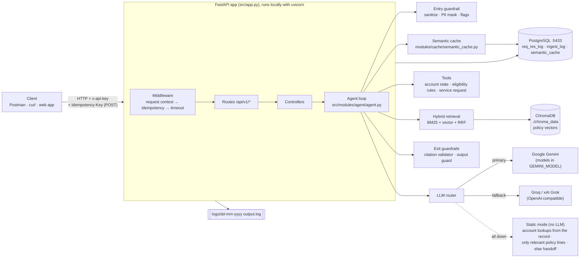
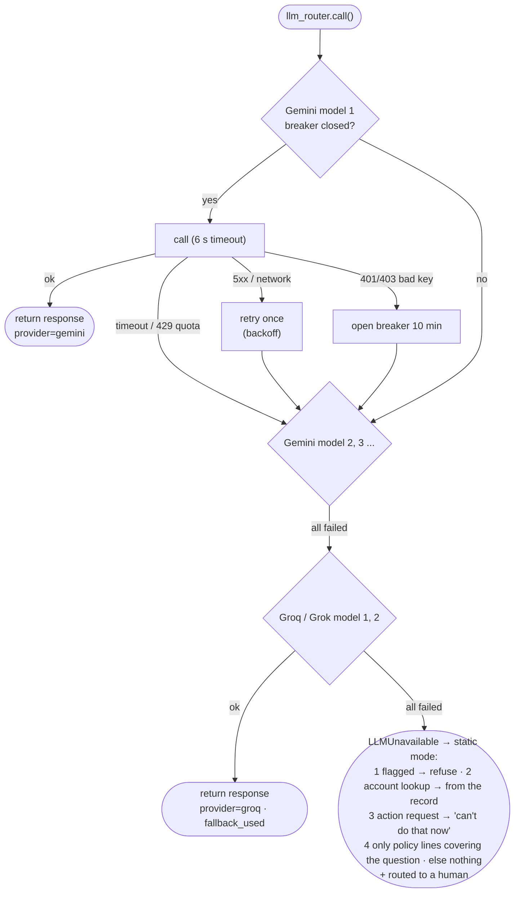
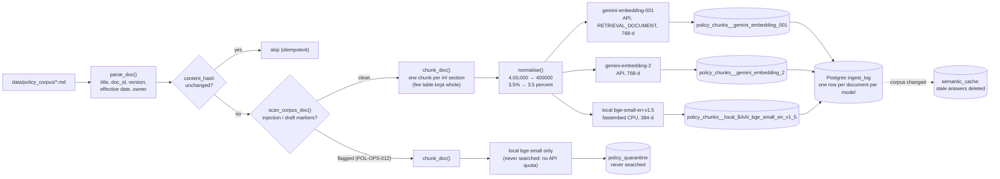
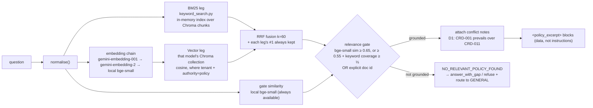
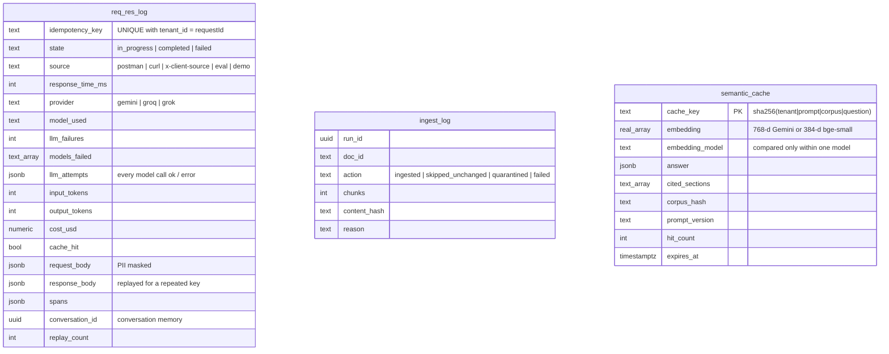
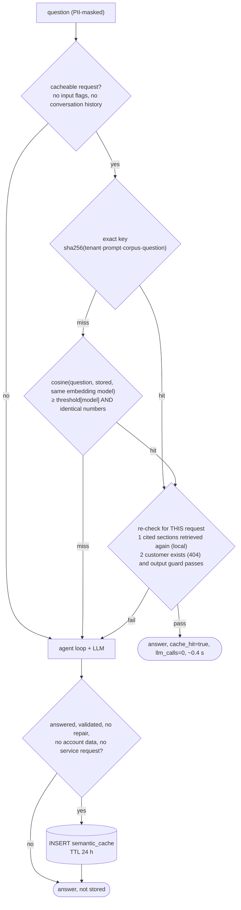
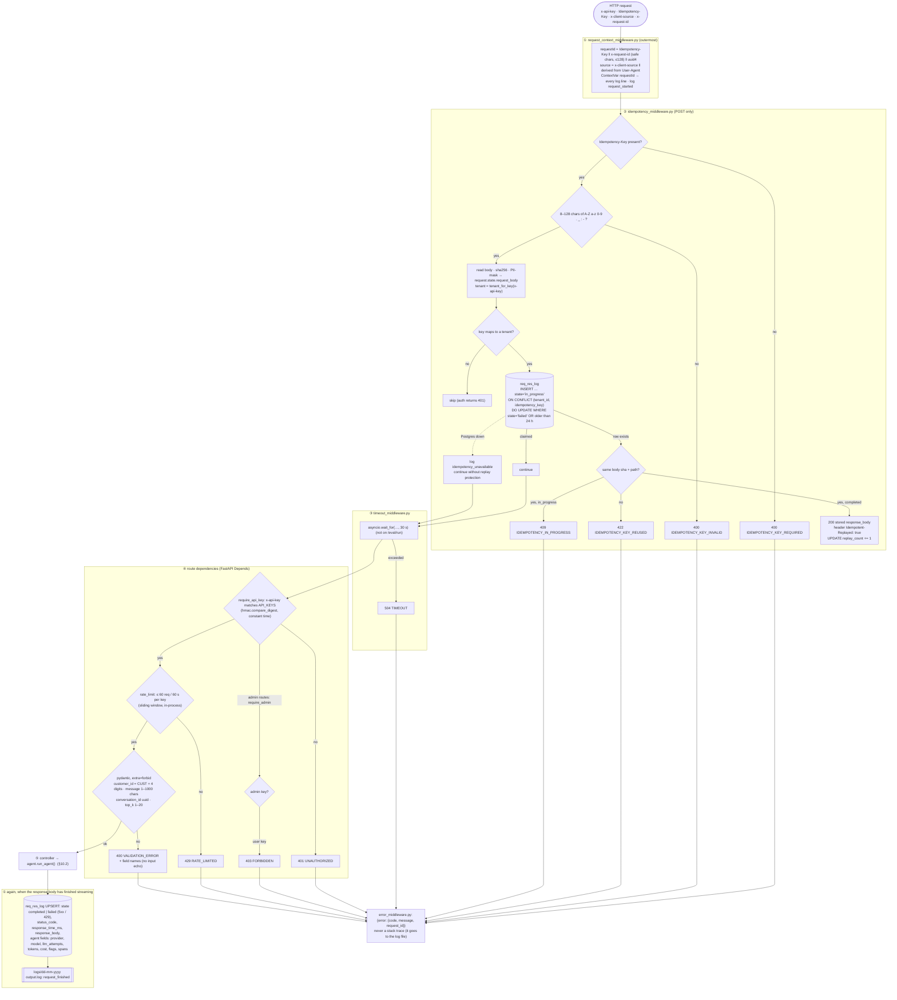
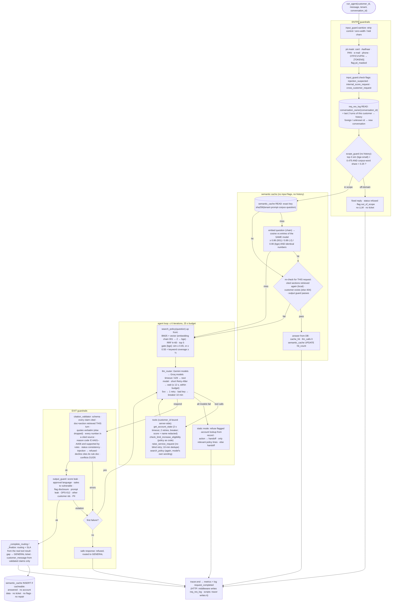
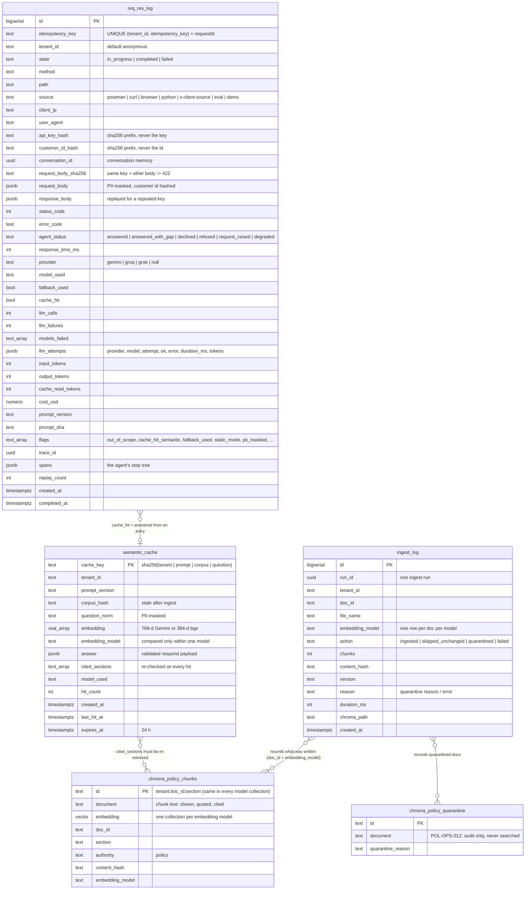

# Architecture and flow

The diagrams are Mermaid. They render on GitHub, and in VS Code with the *Markdown Preview Mermaid Support* extension (`Ctrl+Shift+V`).
Every box names the file that implements it.

## 1. The big picture



| Store | What lives there | Why there |
|---|---|---|
| **ChromaDB** (`./chroma_data`, embedded, no server) | policy chunks + metadata, **one collection per embedding model** (Gemini 001 768-d, Gemini 2 768-d, local bge-small 384-d); quarantined docs in a separate collection | vector similarity search (HNSW, cosine) |
| **PostgreSQL** (local install, port 5433) | exactly **3 tables**: `req_res_log`, `ingest_log`, `semantic_cache` (§7) | relational, queryable: who called, from where, which model answered, what it cost; ingest audit; reusable answers |
| **Files** | prompts (`prompts/system.vN.md`), eval reports (`eval/results/run-*.json/.md`) | versioned / diffable artefacts, not records you query |
| **Log file** (`logs/14-11-2026output.log`) | every event, one JSON line, with file / function / requestId | grep-able debugging when something goes wrong |

## 2. One `/chat` request, end to end

```mermaid
sequenceDiagram
    autonumber
    participant C as Client
    participant M as Middleware
    participant A as Agent (agent.py)
    participant G as Entry guard
    participant R as Retriever
    participant L as LLM router
    participant T as Tools
    participant V as Exit guards
    participant P as Postgres

    C->>M: POST /api/v1/chat {customer_id, message}<br/>x-api-key, Idempotency-Key
    M->>M: requestId = Idempotency-Key → log context
    M->>P: claim req_res_log row for the Idempotency-Key (replay if already completed)
    M->>A: auth ✓ rate limit ✓ schema ✓ → run_agent()
    A->>G: sanitize + mask PII + flag injection / score / cross-customer
    A->>P: semantic_cache lookup (exact key, then cosine ≥ threshold[embedding model] + same numbers)
    alt cache hit, re-checked for this request
        A-->>M: cached answer (no LLM): citations re-retrieved, output guard for this customer
    end
    A->>R: search_policy(question) — before the first model call
    R-->>A: policy excerpts (or NO_RELEVANT_POLICY_FOUND)
    loop max 6 iterations, 25 s budget
        A->>L: system prompt + tools + messages
        L-->>A: tool calls (Gemini; Groq/Grok if Gemini fails)
        A->>T: get_account_state / check_limit_increase_eligibility / raise_service_request / search_policy
        T-->>A: results (customer_id bound server-side, internal score redacted)
    end
    A->>V: respond(payload) → citation validator → output guard
    alt invalid
        V-->>A: errors → ONE repair turn → still invalid → safe response
    end
    A->>P: store answer in semantic_cache (only if account-independent and clean)
    A-->>M: structured answer + trace (LLM attempts, tokens, spans)
    M->>P: complete the req_res_log row: response, response time, model, tokens, cost, failures
    M-->>C: 200 {status, customer_message, claims[citations], decision, routing, meta{provider, model}}
```

## 3. The LLM fallback chain



`LLM_FORCE_PRIMARY_FAIL=1` simulates a Google outage (to demo the fallback). `LLM_DISABLED=1` goes straight to static mode.

## 4. How policy text becomes vectors in ChromaDB (ingest)



Each Chroma record:

| field | example |
|---|---|
| `id` | `default:POL-FEE-007:Table` (tenant:doc:section; re-ingest replaces in place) |
| `document` | `POL-FEE-007 Fees and Charges Schedule §Table: \| Charge \| Amount \| ...` (shown, quoted, cited) |
| `embedding` | 768 floats (Gemini) or 384 (bge-small), unit length |
| `metadata` | `doc_id, tenant_id, section, title, version, owner, effective_date, authority (policy/non_policy), quarantined, quarantine_reason, content_hash, text_norm, token_count, embedding_model` |

**How to see it:** `streamlit run tools/chroma_peek/app.py` (table, embedding map, live similarity query),
`GET /api/v1/admin/vector-store`, or `python -m scripts.ingest` output. Details are in the README section *See the embedded data*.

## 5. Hybrid retrieval



### Embeddings: which model does what (measured on this corpus)

| Measured | gemini-embedding-001 | gemini-embedding-2 | local bge-small-en-v1.5 |
|---|---|---|---|
| Right policy in top 5, hybrid (39 questions incl. paraphrases) | **34** | **34** | not re-measured (MiniLM: 29) |
| Right policy ranked #1, vector | **32** | 28 | not re-measured (MiniLM: 23) |
| Paraphrase ↔ "different detail" similarity (cache) | **0.89–0.92 ↔ 0.81** | 0.90–0.94 ↔ 0.86 | 0.86–0.94 ↔ 0.85 |
| Gate: uncovered questions grounded (of 11) | 4 (0 covered refused) | 9 (0 covered refused) | **2** (2/26 raw covered refused, both grounded after the agent's reformulation; 0.65/0.55) |

So each job uses the model that is best at it:
- **Ranking + semantic cache:** the chain gemini-embedding-001 → gemini-embedding-2 → local bge-small. The first model that answers is used, and that model's own collection.
- **"Is this covered at all?":** the relevance gate always uses local bge-small (it replaced all-MiniLM-L6-v2 on 2026-11-15). It runs in milliseconds, can't run out of quota, and its thresholds were measured on 53 probes; like Gemini it compresses scores (unrelated questions 0.45–0.65), so its margin is thin.
- **When things fail:**
  - Gemini quota or credit exhausted: next Gemini model, then local bge-small. Each has its own quota and collection, and the trace flag shows `embedding_fallback:<model>`.
  - Everything down: BM25 only (keyword coverage ≥ 0.5) and exact-key cache hits; flag `embedding_unavailable`.
- **Keyword half of the gate:** the share of the question's own specific terms (≥ 3 letters, not generic) found in the top BM25 hit. The old "any term matches" rule grounded 6 of 11 uncovered questions; the token "s" from "what's" matched.

## 6. Guardrails: entry and exit

### Entry (before anything reaches the model)

| # | Guardrail | Where | What it stops |
|---|---|---|---|
| 1 | API key (constant-time compare), admin-only routes | `middleware/auth_middleware.py` | anonymous use, users calling admin endpoints |
| 2 | Idempotency-Key required on POST, replay / 409 / 422 | `middleware/idempotency_middleware.py` | duplicate side effects (double service requests) on client retries |
| 3 | Rate limit, 60/min per key | `middleware/rate_limit_middleware.py` | abuse, runaway cost |
| 4 | Schema validation (`extra=forbid`, `CUST-dddd`, 1–1000 chars) | `middleware/validate_middleware.py` | malformed / oversized input |
| 5 | Request timeout 30 s (agent budget 25 s) | `middleware/timeout_middleware.py` | hung requests |
| 6 | Sanitize: strip control, zero-width and bidi characters | `guardrails/input_guard.py` | hidden-text injection, log forging |
| 7 | PII masking: card, Aadhaar, PAN, e-mail, phone, OTP/CVV/PIN | `guardrails/pii.py` | PII reaching the LLM provider, Postgres or logs |
| 8 | Flags: injection, internal-score request, cross-customer id | `guardrails/input_guard.py` | (flags are *enforced* later by the validator) |
| 8b | **Scope check, two tiers, from the corpus only**: off-domain iff the mean similarity of the 3 nearest policy chunks (local bge-small) < 0.475 **and** < 25% of the question's words occur in the policy documents. Off-domain → fixed reply, no LLM, no ticket. In domain but uncovered → normal path (honest gap + GENERAL ticket). Skipped in a conversation (follow-ups need their history); fails open. Measured: 0/40 in-domain blocked, 14/16 off-domain caught | `guardrails/scope_guard.py`, `agent.py::_out_of_scope` | LLM cost and pointless human tickets for "write me a poem" |
| 9 | customer_id bound server-side; no tool takes a customer id; no "approve" tool exists | `agent/tools_schema.py`, `tools/tool_runner.py` | reading another customer's data, approving anything |
| 10 | Internal score + name redacted before the model sees the account | `guardrails/redact.py` | score leakage at the source |
| 11 | Corpus quarantine at ingest (separate collection) | `scripts/ingest.py`, `db/chroma.py` | indirect prompt injection from documents (POL-OPS-012) |
| 12 | Retrieved text wrapped as `<policy_excerpt>` data | `retrieval/retriever.py` + prompt | instructions hidden inside documents |

### Exit (before anything reaches the customer)

| # | Guardrail | Where | What it stops |
|---|---|---|---|
| 1 | Schema check of the `respond` payload | `guardrails/citation_validator.py` | unstructured / malformed answers |
| 2 | Every claim cited; cited doc+section must have been retrieved **this turn** | same | invented sources, citing the quarantined doc |
| 3 | Quotes must be verbatim (else dropped, never shown) | same | fake quotations |
| 4 | Every number in a claim must appear in a cited source or computed fact | same | invented fees, rates, dates, multipliers |
| 5 | Reason codes only AA01–AA06 and only those the rules engine returned | same | invented / misapplied decline reasons |
| 6 | Status consistency; injection / cross-customer ⇒ `refused`; a decline cites its rule doc; a raised request cites POL-SVC-006 | same | policy behaviour left to the model's discretion |
| 7 | Conflicts: never rely on the losing doc alone (D1/D5) | same | superseded policy |
| 8 | Output guard: internal score, approval language, sales to vulnerable customers, flag disclosure, prompt leak, OPS-012, other customers' ids, **PII** | `guardrails/output_guard.py` | leaks and forbidden content |
| 9 | One repair turn, then a safe response (never a guess) | `agent/agent.py`, `agent/safe_responses.py` | shipping an unverified answer |
| 10 | Request bookkeeping from the real tool result (request id, queue, SLA) | `agent/agent.py::_complete_routing` | invented reference numbers |
| 11 | Error envelope without stack traces | `middleware/error_middleware.py` | internal detail leaking in errors |
| 12 | **Static-mode relevance rules** (no LLM to judge): flagged → refuse; plain account lookup → from the record; action request → no excerpt; otherwise only the policy lines covering ≥ ⅔ of the question's key terms (terms unknown to the corpus ignored), else no excerpt | `agent/static_answers.py`, `agent/safe_responses.py::static_mode` | irrelevant policy dumped as an "answer" (found live: "When is my payment due?" returned the whole fee table) |

## 7. Postgres: three tables



| Table | One row per | Answers the question |
|---|---|---|
| `req_res_log` | API call (and per eval/demo turn) | Who called, from where, with which key? How long did it take? Which provider/model answered, which failed and why, how many tokens/credits? Was it a cache hit or a replay? What exactly was asked (masked) and answered? |
| `ingest_log` | document per ingest run | What was embedded into Chroma, when, what was skipped or quarantined, what failed? |
| `semantic_cache` | reusable answer | Can this question be answered from the database instead of the LLM? |

It also does the work of the tables that were removed:
- **Idempotency:** the claimed `req_res_log` row is the lock, and its `response_body` is what a replay returns.
- **Conversation memory:** the last turns with the same `conversation_id` and customer hash.
- **Traces:** the `spans` and `llm_attempts` columns.
- **Prompt versions:** `prompt_version` and `prompt_sha` on every row, with the prompt text in files.
- **Eval runs:** report files.
- **Service-request dedupe:** a 10-minute in-process map.

## 8. Semantic cache: answering from the database



* **Thresholds are per embedding model** (their scales differ), measured on "how much is the foreign currency markup?":

  | Compared with | gemini-embedding-001 | gemini-embedding-2 | bge-small |
  |---|---|---|---|
  | "what is foreign currency markup?" (paraphrase) | 0.918 | 0.940 | 0.938 |
  | "forex markup charges?" (paraphrase) | 0.892 | 0.904 | 0.861 (misses: below 0.90) |
  | "…markup on my Classic card?" (different detail) | 0.814 | 0.861 | 0.849 |
  | "What is the late payment fee?" (different question) | 0.561 | 0.714 | 0.678 ("annual fee?") |
  | **threshold** | **0.86** | **0.89** | **0.90** |

  An entry is only compared with questions embedded by the **same** model (`semantic_cache.embedding_model`).
* **Why not the embedding as the primary key:** float vectors never compare equal, so the key would only match the identical question. The hash key gives an O(1) exact path; the stored embedding gives the semantic path.
* **Invalidation:**
  - **New prompt version:** a different scope, so old entries are never matched.
  - **Re-ingested corpus:** the corpus hash changes, and ingest deletes the stale rows.
  - **Expiry:** `expires_at` (24 h).
  - **By hand:** `DELETE /admin/cache`.
* **Next phase: Redis.** Today the cosine scan runs in Python over at most 2,000 rows per lookup, inside one API process, and Postgres has no vector index. With several API workers or nodes, or a large cache, move it to **Redis**:
  - RediSearch HNSW vector index (`FT.SEARCH … KNN`) for the semantic match;
  - a native TTL per key;
  - sub-millisecond reads, shared by every worker.

  The lookup and store functions in `semantic_cache.py` are the only code to swap. pgvector is the alternative if it should stay in Postgres.
  The same move applies to the other in-process state: rate-limit windows, circuit breakers, service-request dedupe, and the embedding / retrieval LRU caches.

## 9. Logging

* **File log**: `logs/<dd-mm-yyyy>output.log`, one JSON object per line:
  ```json
  {"date": "2026-11-14 23:01:26.182", "type": "error",
   "message": "Grounded-Card-RAG | src/controller | chat_controller.py | worker | requestId: e2e-stream-0001 | message: chat_stream_failed",
   "stack": "Traceback (most recent call last): ..."}
  ```
  `requestId` is the call's Idempotency-Key (or `x-request-id`, or a generated uuid). The same id appears in four places, so it ties them together:
  - `req_res_log.idempotency_key`;
  - the `x-request-id` response header;
  - every log line of that call;
  - the error envelope.
* **`GET /api/v1/requests/summary`** reads `req_res_log` for usage by source, failures by model and answer quality by model. **`GET /api/v1/requests/{requestId}`** returns the full row: request, response, LLM attempts and spans.

## 10. Low-level design

Every check a request passes through, in order: its failure code, and the database reads and writes it makes. Numbers are
the live defaults from `src/const/config.py` (all overridable in `.env`).

### 10.1 HTTP layer: middleware and route dependencies

Starlette runs the last-added middleware first, so the order is request context → idempotency → timeout → route
dependencies (auth → rate limit → body validation) → controller.



### 10.2 Agent pipeline: entry guards → answer → exit guards



### 10.3 Database schema (Postgres, 3 tables) and vector store (ChromaDB)



Indexes:
- **`req_res_log`:** a unique index on `(tenant_id, idempotency_key)`, which is the idempotency lock, plus `(created_at)`, `(source, created_at)`, `(provider, model_used)` and `(conversation_id, created_at)`.
- **`ingest_log`:** `(run_id)` and `(doc_id, created_at)`.
- **`semantic_cache`:** `(tenant_id, prompt_version, corpus_hash, embedding_model)`.

There are no foreign keys between the tables on purpose. A log row must be writable even if the related row is gone or was never written (best-effort telemetry).

### 10.4 Which step touches which store

| Step | `req_res_log` | `semantic_cache` | `ingest_log` | Chroma | If the store is down |
|---|---|---|---|---|---|
| idempotency claim / replay | INSERT/UPDATE · READ | | | | proceed without replay protection (logged) |
| conversation memory | READ | | | | answer without history |
| scope guard | | | | READ (bge, top-3) | fail open: in scope |
| semantic cache | | READ, then UPDATE hit_count | | READ (re-check) | treat as a miss |
| retrieval | | | | READ (one collection per model) + BM25 in memory | BM25 only / static mode |
| store the answer | | INSERT | | | answer anyway |
| end of call | UPSERT (full row) | | | | logged `req_res_log_write_failed` |
| ingest (script / admin) | | DELETE stale rows | INSERT per doc per model | WRITE | doc marked `failed`; re-run retries it |

### 10.5 API catalogue (`/api/v1`)

| Method | Path | Key | Idempotency-Key | Rate limit | Writes | Main errors |
|---|---|---|---|---|---|---|
| GET | `/health` | none | – | – | – | – |
| GET | `/ready` | none | – | – | – | 503 if Postgres / Chroma / corpus / prompt missing |
| POST | `/chat` | user | **required** | 60/min | req_res_log, semantic_cache | 400 · 401 · 404 CUSTOMER_NOT_FOUND · 409 · 422 · 429 · 504 |
| POST | `/chat/stream` | user | **required** | 60/min | same (final answer stored for replay) | same; SSE `error` event |
| POST | `/retrieval/search` | user | **required** | 60/min | req_res_log | 400 · 401 · 429 |
| GET | `/requests`, `/requests/summary`, `/requests/{id}` | user | – | – | – | 401 · 404 |
| GET | `/metrics` (JSON / `Accept: text/plain`) | user | – | – | – | 401 |
| GET | `/prompts`, `/prompts/active` | user | – | – | – | 401 |
| POST | `/admin/ingest[?force=true]` | admin | **required** | – | Chroma, ingest_log, semantic_cache (stale delete) | 401 · 403 |
| GET | `/admin/ingest/runs[/{run_id}]` | admin | – | – | – | 401 · 403 · 404 |
| GET / DELETE | `/admin/cache` | admin | – | – | DELETE clears semantic_cache | 401 · 403 |
| GET | `/admin/vector-store[?doc_id=]` | admin | – | – | – | 401 · 403 |
| POST | `/eval/run` | admin | **required** | – | eval/results files, req_res_log (source eval) | 401 · 403 (no 30 s timeout) |
| GET | `/eval/runs[/{run_id}]` | user | – | – | – | 401 · 404 |

**Designed outcomes are 200, not errors:** `declined`, `refused`, `answered_with_gap`, `degraded`, `out_of_scope`. Only an unknown customer is a 404.

**Error envelope:** `{"error": {"code", "message", "request_id"}}`. `request_id` equals the Idempotency-Key, so it matches the log file and `req_res_log`.
