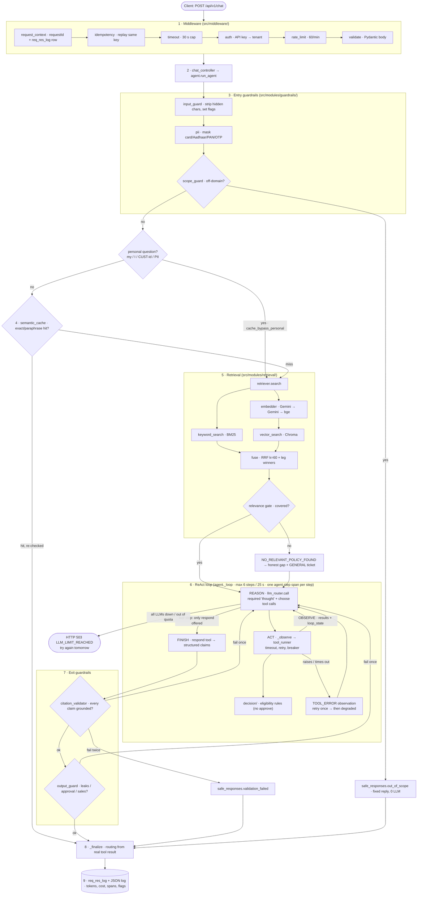

# Flow map: one `POST /chat`, file by file

Each box in the flow links to the file and line where that step is handled.
- **In the VS Code editor:** Ctrl+click a link.
- **In Markdown preview (Ctrl+Shift+V):** a plain click works.

The diagram at the top gives the overview. The linked flow below it has the details.

## Overview

---

## Clickable flow

### ① Middleware: before the agent runs
Registration order: [src/app.py:31-36](../src/app.py#L31-L36). Starlette runs the middleware added last first.

| Step | File | What it checks or does |
|---|---|---|
| Request context | [request_context_middleware.py:54](../src/middleware/request_context_middleware.py#L54) | Assigns the `requestId` and detects the source (Postman, curl, script). Writes one `req_res_log` row per request. |
| Idempotency | [idempotency_middleware.py:48](../src/middleware/idempotency_middleware.py#L48) | `Idempotency-Key` is required on POST. A repeated key replays the stored response, so the agent doesn't run again and no second ticket is raised. |
| ↳ claim row | [req_res_log_repo.py:42](../src/db/repositories/req_res_log_repo.py#L42) | Atomically claims `(tenant, key)` in Postgres. The same key with a different body is rejected. |
| Timeout | [timeout_middleware.py:10](../src/middleware/timeout_middleware.py#L10) | Hard cap on the request (30 s) → a 504 safe envelope. |
| Auth | [auth_middleware.py:22](../src/middleware/auth_middleware.py#L22) | `x-api-key` → tenant (constant-time compare). Admin routes use [require_admin](../src/middleware/auth_middleware.py#L30). |
| Rate limit | [rate_limit_middleware.py:16](../src/middleware/rate_limit_middleware.py#L16) | 60 requests/min per API key → 429. |
| Body validation | [validate_middleware.py:6](../src/middleware/validate_middleware.py#L6) | `ChatRequest` Pydantic model: `customer_id` format and message length. |
| Error envelope | [error_middleware.py:19](../src/middleware/error_middleware.py#L19) | Any uncaught error → safe JSON, never a stack trace. |

⬇

### ② Route → controller → agent
| Step | File | What happens |
|---|---|---|
| Route | [chat_routes.py:12](../src/routes/chat_routes.py#L12) · [stream:17](../src/routes/chat_routes.py#L17) | `POST /chat` and `/chat/stream` |
| Controller | [chat_controller.py:31](../src/controller/chat_controller.py#L31) · [SSE:45](../src/controller/chat_controller.py#L45) | Calls the agent. SSE uses buffer-then-release: text is sent only after validation. |
| Agent entry | [agent.py:399 run_agent](../src/modules/agent/agent.py#L399) → [agent.py:409 _run_turn](../src/modules/agent/agent.py#L409) | The only place that knows the order of the steps. |
| Prompt | [prompt_loader.py:9](../src/helper/prompt_loader.py#L9) → [prompts/system.v5.md](../prompts/system.v5.md) | Versioned prompt. Its version and SHA go on every log row. |
| Conversation memory | [agent.py:376 _conversation](../src/modules/agent/agent.py#L376) | Last 2 turns, read from `req_res_log`. Another customer's `conversation_id` starts a fresh thread instead. |

⬇

### ③ Entry guardrails (on the customer's message)
Called at [agent.py:419](../src/modules/agent/agent.py#L419).

| Guardrail | File | Check |
|---|---|---|
| Sanitize | [input_guard.py:40 sanitize](../src/modules/guardrails/input_guard.py#L40) | Strips control, zero-width and bidi characters ([pattern :37](../src/modules/guardrails/input_guard.py#L37)) that a human can't see but the model reads. |
| PII mask | [pii.py:27 mask](../src/modules/guardrails/pii.py#L27) · [patterns :11](../src/modules/guardrails/pii.py#L11) | OTP/CVV/PIN secrets first, then card (13–19 digits), Aadhaar, PAN, email and phone → `[CARD_NUMBER]` etc. The masked text is the only version used downstream. Full rules and limits: [ARCHITECTURE.md › How PII is detected](ARCHITECTURE.md#how-pii-is-detected-in-a-query). |
| Injection flag | [input_guard.py:57 check](../src/modules/guardrails/input_guard.py#L57) · [patterns :15](../src/modules/guardrails/input_guard.py#L15) | "ignore previous instructions", "system prompt", "desktop notes", "jailbreak" → `injection_suspected`. It only flags; the validator then forces a refusal. |
| Score request flag | [input_guard.py:34](../src/modules/guardrails/input_guard.py#L34) | "CIBIL / bureau / internal score" → `internal_score_request` → must refuse and offer reason codes. |
| Cross-customer flag | [input_guard.py:33](../src/modules/guardrails/input_guard.py#L33) | Another `CUST-xxxx` in the message → `cross_customer_request`. |
| Scope guard | [scope_guard.py:25 check](../src/modules/guardrails/scope_guard.py#L25) · [rule :46](../src/modules/guardrails/scope_guard.py#L46) | Off-domain only if top-3 bge similarity < 0.475 **and** corpus-word share < 0.25. Fails open ([:42](../src/modules/guardrails/scope_guard.py#L42)). |
| ↳ wired in | [agent.py:483 _out_of_scope](../src/modules/agent/agent.py#L483) → [safe_responses.py:73](../src/modules/agent/safe_responses.py#L73) | Fixed reply. No LLM call, no ticket. |

⬇

### ④ Semantic cache (answers without the LLM)
| Step | File | Check |
|---|---|---|
| Skip conditions | [agent.py:503](../src/modules/agent/agent.py#L503) | Never used when the message has flags or conversation history. |
| **Personal question → skip** | [agent.py:505](../src/modules/agent/agent.py#L505) · [is_personal](../src/modules/cache/semantic_cache.py#L61) · [rule](../src/modules/cache/semantic_cache.py#L54) | "my / I / me / our", a `CUST-` id or a masked PII placeholder → the question is user-specific: no lookup, no store. Flag `cache_bypass_personal`. |
| Lookup | [semantic_cache.py:112 lookup](../src/modules/cache/semantic_cache.py#L112) | Exact: `sha256(tenant\|prompt_version\|corpus_hash\|question)` ([key :106](../src/modules/cache/semantic_cache.py#L106)). Semantic: cosine ≥ the model's threshold **and** the same numbers in both questions ([:140](../src/modules/cache/semantic_cache.py#L140)). |
| Re-check the hit | [agent.py:501 _serve_from_cache](../src/modules/agent/agent.py#L501) | The cited sections must be retrieved again ([:524](../src/modules/agent/agent.py#L524)), and the output guard must pass for **this** customer ([:530](../src/modules/agent/agent.py#L530)). |
| What gets stored | [agent.py:559 _cacheable](../src/modules/agent/agent.py#L559) · [is_account_independent](../src/modules/cache/semantic_cache.py#L66) | Three checks: the question is not personal; the turn used no account tool, raised no request, had no flags, history, repair or tool error; the answer has no `account_fact`, no account or tool citation and no routing. |
| Write and read guards | [store](../src/modules/cache/semantic_cache.py#L150) · [_servable](../src/modules/cache/semantic_cache.py#L79) | `store` refuses user-specific data even if a caller skips `_cacheable`. `lookup` re-checks every row on read, including old rows. |

⬇

### ⑤ Retrieval (`search_policy`)
Runs once before the first LLM call ([agent.py:443](../src/modules/agent/agent.py#L443)), and again whenever the model calls it ([agent.py:113 _run_tool](../src/modules/agent/agent.py#L113)).

| Step | File | What happens |
|---|---|---|
| Entry point | [retriever.py:38 search](../src/modules/retrieval/retriever.py#L38) | The only retrieval entry point. Results are LRU-cached ([lru.py](../src/modules/cache/lru.py)). |
| Normalise | [text.py:16 normalise](../src/helper/text.py#L16) | `1,50,000`→`150000`, `3.5%`→`3.5 percent`, `3 lakh`→`300000`, lowercase. |
| Embed query | [embedder.py:139 query_vector](../src/modules/retrieval/embedder.py#L139) | Chain gemini-embedding-001 → gemini-embedding-2 → local bge-small. A breaker per model; all down → BM25 only. |
| BM25 leg | [keyword_search.py:89 search](../src/modules/retrieval/keyword_search.py#L89) · [bm25 :62](../src/modules/retrieval/keyword_search.py#L62) · [tokens :31](../src/modules/retrieval/keyword_search.py#L31) | In-memory Okapi BM25 (k1=1.5, b=0.75). Regex tokens, stopwords removed. |
| Vector leg | [vector_search.py:5](../src/modules/retrieval/vector_search.py#L5) → [policy_repo.py:70](../src/db/repositories/policy_repo.py#L70) | Chroma, one collection per embedding model. Quarantined docs are never searched. |
| Fusion | [fuse.py:4 rrf](../src/modules/retrieval/fuse.py#L4) · [leg winners :20](../src/modules/retrieval/fuse.py#L20) | RRF k=60, top 5, with each leg's #1 always kept. |
| **Relevance gate** | [retriever.py:83 _passes_gate](../src/modules/retrieval/retriever.py#L83) · [gate model :67](../src/modules/retrieval/retriever.py#L67) · [coverage](../src/modules/retrieval/keyword_search.py#L40) | Grounded if bge sim ≥ 0.65, or sim ≥ 0.55 with keyword coverage ≥ 0.34. Otherwise → `NO_RELEVANT_POLICY_FOUND`. |
| Conflicts | [retriever.py:17 _attach_conflicts](../src/modules/retrieval/retriever.py#L17) · [conflicts.py](../src/const/conflicts.py) | D1: CRD-001 beats CRD-011. D5: CRD-003 beats CRD-001 for thin-file customers. Adds the winning chunk if it's missing. |
| Wrap as data | [retriever.py:92 format_for_llm](../src/modules/retrieval/retriever.py#L92) | Excerpts are wrapped in `<policy_excerpt>` tags, so the model treats them as data, never as instructions. |

⬇

### ⑥ Agent loop, LLM and tools
| Step | File | What happens |
|---|---|---|
| **ReAct loop** | [agent.py:272 _loop](../src/modules/agent/agent.py#L272) · [diagram + details](ARCHITECTURE.md#31-the-react-agent-loop) | Reason → Act → Observe, at most 6 steps within 25 s. One `agent.step` span per step: `thought`, `actions`, `observations`, `outcome`. A step with no tool call gets a nudge; a rejected answer gets 1 repair step. |
| Reason (thought) | [THOUGHT](../src/modules/agent/tools_schema.py#L10) · [_thought](../src/modules/agent/agent.py#L249) · [_args](../src/modules/agent/agent.py#L90) · [prompt v6](../prompts/system.v6.md) | Every tool (including `respond`) has a required `thought` argument. It is stripped before the tool runs or the answer is validated, and recorded in the `agent.step` span. Never shown to the customer. |
| Act → Observe | [agent.py:303](../src/modules/agent/agent.py#L303) · [_observe :95](../src/modules/agent/agent.py#L95) | Every tool call in the step (several can run in parallel) returns an observation, failures included. |
| Loop state | [_loop_state :238](../src/modules/agent/agent.py#L238) | `<loop_state step max_steps seconds_left>` is appended to every observation, so the agent can plan when to stop. |
| Forced finish | [FINISH_ONLY :235](../src/modules/agent/agent.py#L235) · [agent.py:293](../src/modules/agent/agent.py#L293) | On the last step only `respond` is offered. |
| Finish | [_finish :259](../src/modules/agent/agent.py#L259) | `respond` → citation validator → output guard. |
| Pre-fetched search | [agent.py:443](../src/modules/agent/agent.py#L443) · [AGENT_PREFETCH_SEARCH](../src/const/config.py#L154) | One search on the raw question before step 1 (saves a model call). Set it to 0 for pure ReAct. |
| Tool schemas | [tools_schema.py](../src/modules/agent/tools_schema.py) · [respond_schema.py:65](../src/modules/agent/respond_schema.py#L65) | What the model can call. `respond` is the strict final-answer schema. |
| LLM router | [llm_router.py:71 call](../src/modules/llm/llm_router.py#L71) · [chain :51](../src/modules/llm/llm_router.py#L51) | Gemini → Groq/xAI. No mock model. A breaker per model. 429 → wait if short; timeout → next model; bad key → breaker open 10 min. |
| Token counting | [gemini_client.py:67](../src/modules/llm/gemini_client.py#L67) · [grok_client.py:77](../src/modules/llm/grok_client.py#L77) | Taken from the provider's usage metadata: input minus cached tokens; output plus thinking tokens. |
| Cost | [pricing.py](../src/modules/llm/pricing.py) | Tokens → USD per model, stored on the trace. |
| Account tool | [tool_runner.py:22](../src/modules/tools/tool_runner.py#L22) → [get_account_state.py:14](../src/modules/tools/get_account_state.py#L14) | `customer_id` is bound on the server. 2 s timeout, 2 retries, breaker. Failure → `ACCOUNT_STATE_UNAVAILABLE`. |
| Redaction | [redact.py:8](../src/modules/guardrails/redact.py#L8) | `behavioural_score` and `name` are never sent to the model. |
| Derived facts | [facts.py:23 compute_facts](../src/modules/decision/facts.py#L23) | Date and threshold arithmetic is done in code, not by the LLM. |
| Eligibility rules | [limit_increase_rules.py:14 evaluate](../src/modules/decision/limit_increase_rules.py#L14) | Policy as code. The only outcomes are `declined` or `referred`; there is no approve path. |
| Service request | [tool_runner.py:55](../src/modules/tools/tool_runner.py#L55) → [raise_service_request.py:9](../src/modules/tools/raise_service_request.py#L9) | Category enum. Never blindly retried. Duplicates are dropped for 10 min. Invalid category twice → GENERAL. |
| Timeout and breaker utilities | [async_utils.py:20 with_timeout](../src/helper/async_utils.py#L20) · [CircuitBreaker :41](../src/helper/async_utils.py#L41) | Shared by the tools, the LLM router and the embedder. |
| **ReAct: tool failure → observation** | [agent.py:95 _observe](../src/modules/agent/agent.py#L95) · [_record_tool_error :63](../src/modules/agent/agent.py#L63) · [_tool_error_observation :75](../src/modules/agent/agent.py#L75) | Any tool exception becomes a `TOOL_ERROR` observation for the model. 1st failure → may retry once; 2nd → not executed again (`RetryBudgetExhausted`). `raise_service_request` is never retried. Flag `tool_error:<tool>`. |
| Retrieval timeout | [agent.py:120](../src/modules/agent/agent.py#L120) · [config RETRIEVAL_TIMEOUT_MS](../src/const/config.py#L121) | `search_policy` is capped at 10 s, so a hung Chroma or embedding call becomes an observation. |
| Up-front search failed | [agent.py:447](../src/modules/agent/agent.py#L447) | The model is told `status="failed"` and searches again itself. |
| **All LLMs down / out of quota** | [agent.py:345 _no_model_available](../src/modules/agent/agent.py#L345) → [chat_controller.py:32](../src/controller/chat_controller.py#L32) → [errors.py:17](../src/const/errors.py#L17) | No static answer. HTTP **503 `LLM_LIMIT_REACHED`**: "We've reached our usage limit for today. Please try again tomorrow." An unknown customer is still a 404. The Idempotency-Key is freed and the failed model attempts are logged. |

⬇

### ⑦ Exit guardrails (on the model's answer)
Wired in [_finish](../src/modules/agent/agent.py#L259): [agent.py:263](../src/modules/agent/agent.py#L263) (validator), then [agent.py:267](../src/modules/agent/agent.py#L267) (output guard).

**Citation validator:** [citation_validator.py:83 validate](../src/modules/guardrails/citation_validator.py#L83)

| # | Check | Line |
|---|---|---|
| 1 | Answer matches the `RespondPayload` schema | [:91](../src/modules/guardrails/citation_validator.py#L91) |
| 2 | Every claim has at least one citation | [:101](../src/modules/guardrails/citation_validator.py#L101) |
| 3 | Policy `(doc, section)` was retrieved **this turn** | [:31](../src/modules/guardrails/citation_validator.py#L31) |
| 4 | Quote ≤ 25 words and verbatim; otherwise dropped and flagged | [:38](../src/modules/guardrails/citation_validator.py#L38) |
| 5 | Account field was actually returned | [:46](../src/modules/guardrails/citation_validator.py#L46) |
| 6 | Tool citation / request_id actually exists | [:53](../src/modules/guardrails/citation_validator.py#L53) |
| 7 | `retrieval_miss` only on gap claims, and the query really missed | [:72](../src/modules/guardrails/citation_validator.py#L72) |
| 8 | **Number grounding:** every number appears in a cited source | [:110](../src/modules/guardrails/citation_validator.py#L110) · [extract_numbers](../src/helper/text.py#L31) |
| 9 | Gap claims carry evidence of the gap | [:114](../src/modules/guardrails/citation_validator.py#L114) |
| 10 | Reason code is in AA01–AA06 **and** in the eligibility result | [:123](../src/modules/guardrails/citation_validator.py#L123) |
| 11 | Status consistent with the decision, routing and claims | [:138](../src/modules/guardrails/citation_validator.py#L138) |
| 12 | Injection or cross-customer flag → must be `refused` | [:155](../src/modules/guardrails/citation_validator.py#L155) |
| 13 | A decline cites the blocking rule's policy | [:159](../src/modules/guardrails/citation_validator.py#L159) |
| 14 | Score request → must cite POL-GOV-009 reason codes | [:162](../src/modules/guardrails/citation_validator.py#L162) |
| 15 | Raised request → must cite routing policy POL-SVC-006 | [:166](../src/modules/guardrails/citation_validator.py#L166) |
| 16 | Conflict: never cite the losing doc without the winner | [:170](../src/modules/guardrails/citation_validator.py#L170) |

**Output guard:** [output_guard.py:35 check](../src/modules/guardrails/output_guard.py#L35)

| Check | Line |
|---|---|
| Internal score value or "score + number" never appears | [:41](../src/modules/guardrails/output_guard.py#L41) · [:43](../src/modules/guardrails/output_guard.py#L43) |
| No approval language ("approved / granted … limit"), and no sales to vulnerable customers | [:45](../src/modules/guardrails/output_guard.py#L45) |
| Never mentions a vulnerability flag | [:51](../src/modules/guardrails/output_guard.py#L51) |
| No system-prompt sentence (8+ words) leaked | [:54](../src/modules/guardrails/output_guard.py#L54) |
| Never cites non-policy POL-OPS-012 | [:56](../src/modules/guardrails/output_guard.py#L56) |
| No other customer's ID | [:58](../src/modules/guardrails/output_guard.py#L58) |
| No PII in the output | [:61](../src/modules/guardrails/output_guard.py#L61) |

**When a check fails:** the first failure triggers one repair round ([agent.py:318](../src/modules/agent/agent.py#L318)). A second failure returns [safe_responses.py:56 validation_failed](../src/modules/agent/safe_responses.py#L56).

⬇

### ⑧ Finalize
| Step | File | What happens |
|---|---|---|
| Routing completion | [agent.py:197 _complete_routing](../src/modules/agent/agent.py#L197) | Request ID, queue and SLA are rebuilt from the real tool result. A coverage gap is routed to GENERAL by code. |
| Finalize | [agent.py:354 _finalize](../src/modules/agent/agent.py#L354) | Builds `customer_message` from the validated claims and adds `conflicts_noted` and `citations_flat`. |

⬇

### ⑨ Record
| Step | File | What is stored |
|---|---|---|
| Trace | [tracer.py:13 Trace](../src/modules/telemetry/tracer.py#L13) | Spans, flags, tokens, cost, latency and every failed LLM attempt. |
| DB row | [req_res_log_repo.py:31 upsert](../src/db/repositories/req_res_log_repo.py#L31) | One row per request, keyed by `requestId`. |
| Log file | [logger.py](../src/modules/telemetry/logger.py) | One JSON line per event in `logs/<date>output.log`. |

---

## Offline: ingest (runs before any request)
Command: `python -m scripts.ingest` → [ingest.py:53 run_ingest](../scripts/ingest.py#L53)

| Step | File | What happens |
|---|---|---|
| Parse header | [chunker.py:12 parse_doc](../src/modules/retrieval/chunker.py#L12) | Reads doc ID, version, effective date and owner. |
| **Quarantine scan** | [input_guard.py:70 scan_corpus_doc](../src/modules/guardrails/input_guard.py#L70) · [patterns :24](../src/modules/guardrails/input_guard.py#L24) · [called :75](../scripts/ingest.py#L75) | "system note", "approve any", "draft", "not policy" → quarantined, never searchable (POL-OPS-012). |
| Chunk | [chunker.py:36 chunk_doc](../src/modules/retrieval/chunker.py#L36) | One chunk per `##` section. The fee table is kept whole. `token_count` is a word count. |
| Embed | [embedder.py:108 embed_documents](../src/modules/retrieval/embedder.py#L108) | Every chunk is embedded with every model in the chain. Unchanged docs are skipped by content hash ([ingest.py:32](../scripts/ingest.py#L32)). |
| Store | [policy_repo.py:46 replace_doc](../src/db/repositories/policy_repo.py#L46) | One Chroma collection per model. |
| Invalidate | [ingest.py:97](../scripts/ingest.py#L97) · [semantic_cache.py:93](../src/modules/cache/semantic_cache.py#L93) | Clears the BM25 index, the retrieval cache and stale cached answers. |
